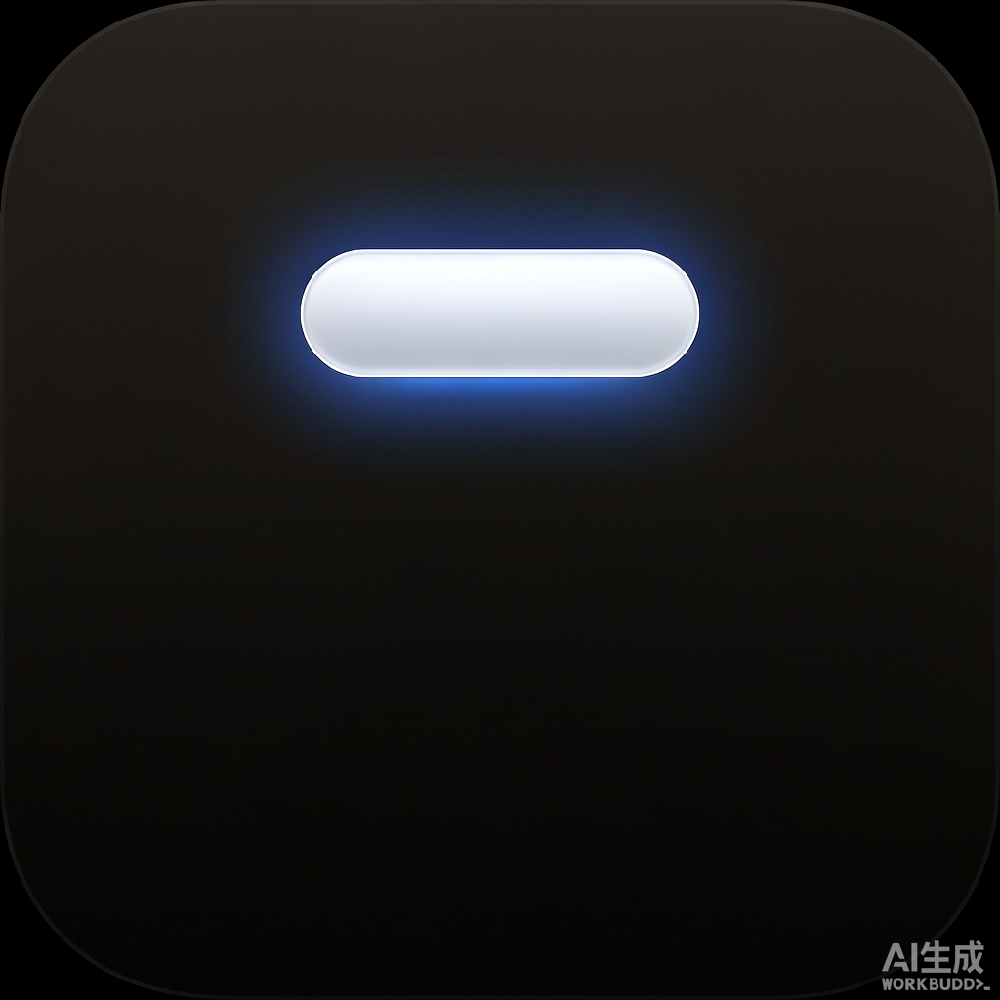

  

<h1 align="center">Z-island</h1>

MacBook 刘海上的小工具：放文件、翻剪贴板、看音量。

  
  
  

## 它能帮你做什么

**一个临时放文件的地方。**
把文件拖到屏幕上方的刘海，它会先替你收着。要用的时候从里面拖出来就行，不用再翻半天文件夹。关掉电脑也不会丢。

**一个能找回刚才复制的东西的地方。**
复制过的文字、图片、文件它都记着，点一下就能重新粘贴。再也不怕覆盖掉上一条。

**调音量、亮度的时候不挡屏幕。**
按音量键、亮度键、键盘灯键，提示会直接出现在刘海上，不像系统自带的那样在屏幕中间糊一大块。

## 怎么用

把鼠标挪到刘海位置，面板自己就会展开；挪开就收起。

菜单栏有一个小图标，点开可以：切换面板样式（宽一点 / 窄一点）、让它在开机时自动启动、显示或隐藏图标、检查更新、退出。

## 为什么推荐它

只做上面这几件事。没有音乐播放器、没有日历、没有天气、没有后台常驻的各种监控，所以它启动快、占内存少，装了就忘，需要时抬头就是。

## 怎么装

1. 到 [Releases](https://github.com/zevin-zh/Z-island/releases) 下载最新的 `.dmg`
2. 打开它，把 Z-island 拖进「应用程序」
3. 第一次打开如果提示"来自身份不明的开发者"，在应用上**右键 → 打开**，再点一次「打开」就好（只需要这一次）

第一次运行会请求一两个系统权限，按提示在「系统设置 › 隐私与安全性」里打开即可，否则鼠标移到刘海上不会有反应。

## 系统要求

macOS 15 或更新，带刘海的 MacBook Pro。

## 许可

GPL-3.0。基于 [Atoll](https://github.com/Ebullioscopic/Atoll) 精简而来，原始版权与第三方许可见 [LICENSE](LICENSE) 与 [NOTICE](NOTICE)。
